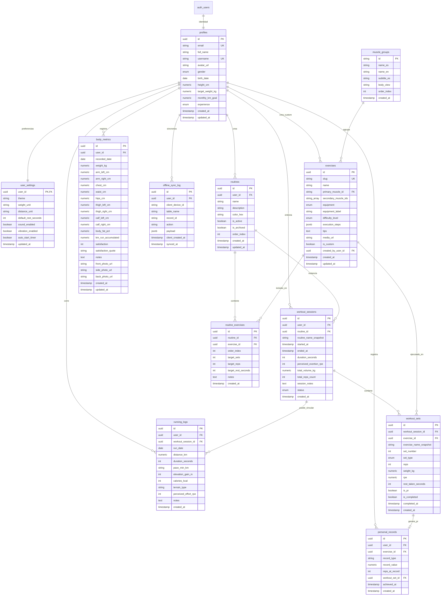

# Fitmate - Arquitectura y Estructura de Base de Datos

Documento técnico con la especificación completa del modelo de datos para **Fitmate: Your Gym Buddy**, diseñado para PostgreSQL y Supabase con soporte para arquitectura Offline-First.

---

## 1. Diagrama Entidad-Relación (ERD)

---

## 2. Diccionario de Datos y Módulos

### 2.1 Usuarios, Identidad y Configuración
* **`profiles`**: Almacena datos biométricos de referencia del atleta (altura, peso objetivo, meta mensual de kilómetros de running, nivel de experiencia). Se sincroniza de forma transparente con `auth.users` mediante triggers PL/pgSQL.
* **`user_settings`**: Guarda preferencias funcionales: tiempo de descanso por defecto del cronómetro (ej. 90s), unidades preferidas (`kg` o `lbs`, `km` o `mi`), alertas sonoras y hápticas.

### 2.2 Catálogo de Anatomía & Ejercicios (Estilo MuscleWiki)
* **`muscle_groups`**: Catálogo base para la visualización del mapa muscular anatómico interactivo (frente/espalda). Mapea zonas: Pecho, Deltoides, Bíceps, Tríceps, Antebrazos, Core/Abdomen, Trapecios, Dorsales, Lumbares, Glúteos, Cuádriceps, Aductores, Isquiotibiales y Gemelos.
* **`exercises`**: Catálogo completo de ejercicios que incluye tipo de equipamiento (Barra, Mancuerna, Polea/Máquina, Peso Corporal), niveles de dificultad, instrucciones paso a paso estructuradas en `jsonb` y el tip técnico exclusivo de Fitmate. Permite además a los usuarios crear sus propios ejercicios personalizados (`is_custom = true`).

### 2.3 Planificación y Rutinas
* **`routines`**: Plantillas creadas por el usuario o sugeridas (Empuje, Tirón, Piernas, Fullbody, etc.).
* **`routine_exercises`**: Lista ordenada de ejercicios configurados en cada rutina, con objetivos de series, repeticiones y tiempo de descanso previsto.

### 2.4 Registro de Entrenamientos y Detección Automática de Récords
* **`workout_sessions`**: Representa una sesión real ejecutada en el gimnasio, guardando duración exacta, RPE (esfuerzo percibido 1-10) y volumen total levantado.
* **`workout_sets`**: Cada serie completada con repeticiones, carga en kg, tipo de serie (calentamiento, efectiva, dropset, fallo) y si supuso un récord personal (`is_pr`).
* **`personal_records`**: Almacena el histórico y estado actual de récords máximos por ejercicio. **Se actualiza automáticamente vía trigger en la base de datos** al guardar una serie con mayor peso.

### 2.5 Seguimiento Corporal Integral (El diferencial de Fitmate)
* **`body_metrics`**:
  * **Peso corporal** con decimales.
  * **Medición bilateral de brazos** (`arm_left_cm` y `arm_right_cm`) para monitorear asimetrías musculares.
  * Medidas completas: Pecho, cintura, cadera, muslos y pantorrillas.
  * **Control mensual de running**: Kilómetros acumulados en el mes vs. objetivo.
  * **Calificación de satisfacción emocional/física (1 a 10)**: con frases motivacionales dinámicas basadas en el progreso.
  * Notas personales y URLs de fotos de progreso (frente, perfil, espalda).

### 2.6 Running y Actividad Aeróbica
* **`running_logs`**: Detalle de cada sesión de trote o carrera (distancia, duración, ritmo min/km, elevación, calorías y terreno).

### 2.7 Sincronización Offline-First
* **`offline_sync_log`**: Cola de mutaciones capturadas localmente en el móvil/navegador cuando el usuario entrena en sótanos o zonas sin cobertura WiFi en el gimnasio. Al recuperar la conexión, el cliente procesa la cola y la base de datos resuelve conflictos con marcas de tiempo `client_created_at`.

---

## 3. Seguridad y Row Level Security (RLS)

Todas las tablas de usuario tienen activado **Row Level Security (RLS)**:
1. `profiles`, `routines`, `workout_sessions`, `body_metrics`, etc. solo pueden ser consultadas o modificadas por el usuario autenticado (`auth.uid() = user_id`).
2. El catálogo de músculos y ejercicios base es de libre lectura (`SELECT`) para cualquier usuario conectado o anónimo en modo explorador.
3. Los triggers del sistema (`handle_new_user_signup`, `check_and_update_personal_record`) corren con permisos controlados `SECURITY DEFINER` para garantizar la integridad sin exponer datos a otros usuarios.
