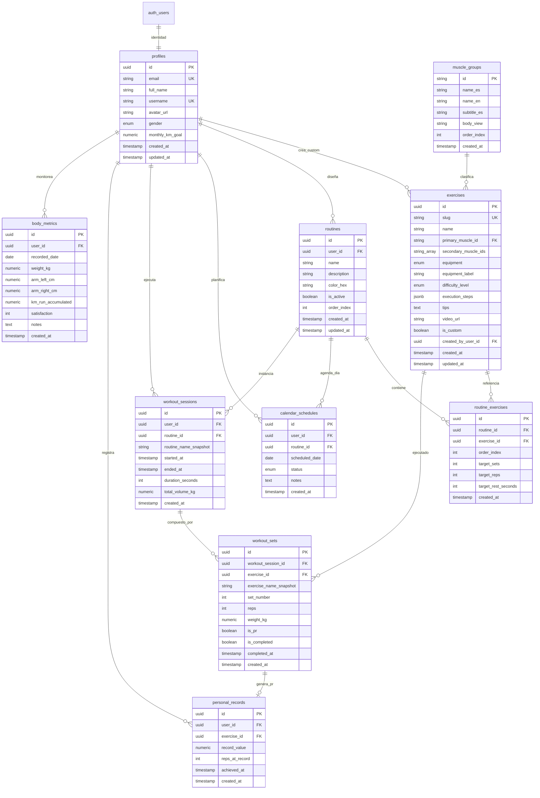

# Fitmate - Arquitectura y Estructura de Base de Datos v2.1

Documento técnico de especificación para **fitmate: Your Gym Buddy**, aplicación móvil PWA Offline-First con PostgreSQL / Supabase.

---

## 1. Diagrama Entidad-Relación (ERD)

---

## 2. Los 5 Módulos y su Mapeo de Datos

1. **Módulo 1: Explorador Anatómico (MuscleWiki + Creador de Ejercicios)**
   - Tablas: `muscle_groups` y `exercises`.
   - Soporte para ejercicios precargados del sistema y ejercicios personalizados creados por el usuario (`is_custom = true`).

2. **Módulo 2: Gestor de Rutinas & Registro de Entrenamiento en Vivo**
   - Tablas: `routines`, `routine_exercises`, `workout_sessions`, `workout_sets`, `personal_records`.
   - Permite crear, clonar, editar y eliminar rutinas.
   - Live Tracking registra pesos, repeticiones y detecta automáticamente nuevos récords (PRs).

3. **Módulo 3: Calendario de Planificación (Drag & Drop)**
   - Tabla: `calendar_schedules`.
   - Agendamiento semanal y mensual con arrastrar y soltar, vinculando una rutina a fechas `scheduled_date` con estados `planned` y `completed`.

4. **Módulo 4: Marcas Corporales & Rendimiento Físico**
   - Tabla: `body_metrics`.
   - Registra peso corporal con decimales, asimetría de brazos (`arm_left_cm` y `arm_right_cm`), acumulador de running mensual y satisfacción (escala 1 a 10).

5. **Módulo 5: Dashboard de Progreso & Analítica**
   - Agrega KPIs en tiempo real y genera curvas temporales mediante Chart.js.
